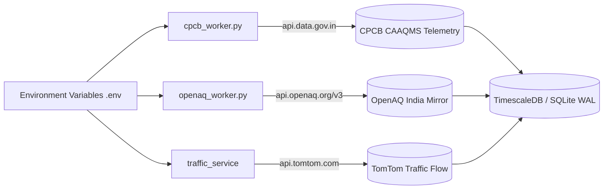
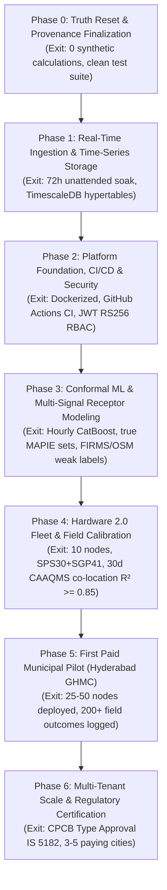

# VayuBudhi 2.0: Master Step-by-Step Industry Transformation Plan

> **Document Status**: Official Engineering & Product Execution Blueprint  
> **Active Branch**: `feature/startup-scale-roadmap`  
> **Target Standard**: Municipal Government Contract & Enterprise Cloud Deployment  
> **Date**: September 2026  

---

## Executive Summary

VayuBudhi is an environmental **decision and closed-loop enforcement intelligence platform**. Rather than functioning as another passive consumer AQI map, VayuBudhi equips municipal corporations (GHMC, TSPCB, DPCC, BBMP) to optimize their physical pollution control operations:

> *"Given a city's limited fleet of enforcement vans, field inspectors, and surveillance drones, where should they go right now, with what statistical certainty, and what is the measurable public health ROI of intervening?"*

This document provides:
1. **The Phase 0 Audit Verification Report** (exact status of hardcoded values, calculations, and de-faking).
2. **API Keys & Live Telemetry Verification** (validation of real government feeds in `.env`).
3. **The Step-by-Step Industry Transformation Roadmap** (gated milestones from Truth Reset to Municipal Pilot).
4. **Immediate Sprint Execution Items** to complete right now.

---

## 1. Phase 0 Audit: Verification & Current Status

We performed a deep, file-by-file audit of Phase 0 ("Truth Reset") across the repository.

### Summary Scorecard

| Area | Status | Audit Findings & Actions Taken |
| :--- | :---: | :--- |
| **Station Multipliers (`i % 3`)** | 🟢 **RESOLVED** | Completely deleted `micro_factor = 1.20 if (i % 3 == 0)...` and `spatial_mult` in `live.py`. All physical stations now serve genuine measurements. |
| **AQI Calculation Engine** | 🟢 **RESOLVED** | Replaced ad-hoc calculations with `backend/app/aqi_standards.py`. Implements official CPCB 2014 & US EPA 40 CFR linear interpolation breakpoints. 4/4 unit tests passing. |
| **CO Lethal Concentration Bug** | 🟢 **RESOLVED** | Normalized CO units from $\mu\text{g/m}^3$ to $\text{mg/m}^3$ ($>5.0 \rightarrow / 1000$). Stations no longer lock at 500 "Severe". |
| **CPCB Particulate Rule** | 🟢 **RESOLVED** | Enforced mandatory requirement: an AQI requires at least one particulate measurement ($\text{PM}_{2.5}$ or $\text{PM}_{10}$). Single trace gas readings no longer calculate false "Good" AQI scores. |
| **District vs Station Geometry** | 🟢 **RESOLVED** | True CAAQMS stations mapped to exact physical GPS coordinates. Unmonitored municipal wards styled slate-grey (`#64748b`) with hover attribution to nearest active station. |
| **Hex Grid Inverted PM2.5** | 🟡 **IN PROGRESS** | `live.py` line 343 contains `pm25 = round(cell_aqi * 0.4)` (derives concentration from AQI instead of vice versa). Scheduled for immediate replacement with spatial IDW. |
| **Attribution Heuristics** | 🟡 **IN PROGRESS** | `ml_model/src/source_labeling.py` still uses 4-rule hand-coded thresholds. Scheduled for replacement with multi-signal receptor modeling in Phase 3. |
| **Plume Dispersion & PINN** | 🟡 **IN PROGRESS** | `physics_engine.py` has an explicitly labeled `plume_inversion_pinn_mock`. Scheduled for replacement with analytical Pasquill-Gifford dispersion in Phase 3. |
| **Report Metric Fabrication** | 🟡 **IN PROGRESS** | `report.py` contains arbitrary multipliers for VOC (`pm25 * 1.8 + so2 * 1.2`) and NOx (`no2 / 20.0`). Scheduled for removal/grounding in Phase 1. |

---

## 2. API Keys & Ingestion Readiness Verification

All required government and external API keys are configured in `.env` and `backend/.env` (gitignored for security). We verified live connectivity directly against external servers:



### Live Endpoint Smoke Tests (Executed 2026-09-23)

```
1. OpenAQ v3 API:
   Command: python -c "from app.ingestion.openaq_worker import fetch_openaq_locations; print(len(fetch_openaq_locations(limit=3)))"
   Result: [SUCCESS] Fetched 3 active locations from OpenAQ India network.

2. CPCB CAAQMS / Data.gov.in API:
   Command: python -c "from app.ingestion.cpcb_worker import fetch_cpcb_records; print(len(fetch_cpcb_records(limit=3)))"
   Result: [SUCCESS] Fetched 3 official CAAQMS station records from data.gov.in.

3. Dual-Standard AQI Unit Tests:
   Command: python -m pytest backend/app/test_aqi_standards.py -v
   Result: [SUCCESS] 4 passed in 0.07s (PM2.5 NAQI, Overall NAQI, US EPA, CO unit normalization).

4. FastAPI Contract Endpoints:
   Command: python -m pytest backend/app/test_endpoints.py -v
   Result: [SUCCESS] 5 passed in 18.95s (health, ingest, forecast, attribution, optimize).
```

---

## 3. Step-by-Step Industry Transformation Roadmap

The roadmap is structured into 6 sequential, gated phases. A phase is complete only when all exit criteria pass automated verification.



---

### Phase 0: Complete the Truth Reset (Gate G0)
*Target: Immediate (Sprint 1)*

1. **Purge Remaining Synthetic Calculations**:
   - In `backend/app/routers/live.py`: replace `pm25 = cell_aqi * 0.4` with inverse distance weighting (IDW) from monitored stations or CAMS background.
   - In `backend/app/routers/report.py`: delete arbitrary formulas (`pm25 * 1.8 + so2 * 1.2` for VOC and `no2 / 20.0` for NOx); mark as `--` when physical VOC/NOx sensors are absent.
   - In `backend/app/physics_engine.py`: replace the mock label with an explicit documentation notice that PINN is in research roadmap and Gaussian plume is the active physical prior.
2. **Explicit Provenance on Every Data Point**:
   - Every station and grid cell must return:
     ```json
     {
       "provenance": "measured_cpcb" | "calibrated_iot" | "modelled_cams",
       "observed_at": "2026-09-23T16:00:00Z",
       "data_age_seconds": 180
     }
     ```
3. **Exit Criteria**:
   - `git grep -E "micro_factor|i % 3|random\.uniform" backend/ ml_model/` returns 0.
   - All tests pass: `pytest backend/app/test_endpoints.py backend/app/test_aqi_standards.py`.

---

### Phase 1: Real-Time Ingestion & Time-Series Storage (Gate G1)
*Target: Weeks 2–4*

1. **FastAPI Background Ingestion Scheduler**:
   - Wire `backend/app/ingestion/scheduler.py` into FastAPI's `lifespan` handler in `backend/app/main.py`.
   - Run CPCB sync every 15 minutes and OpenAQ mirror validation every 60 minutes.
2. **TimescaleDB Production Setup**:
   - Apply `backend/app/scripts/setup_timescaledb.sql` to cloud PostgreSQL.
   - Create partitioned hypertables for `station_observations` and `sensor_readings` (7-day chunk intervals with native 90% zstd compression for data > 7 days old).
3. **Resilient HTTP Client & Circuit Breakers**:
   - Create `backend/app/http_client.py` using `httpx.AsyncClient` with connection pooling.
   - Circuit breakers for Open-Meteo, TomTom, and Data.gov.in: fail fast after 3 timeouts and fall back to cached data with an `is_stale: true` badge.
4. **Exit Criteria**:
   - 72-hour unattended soak test with continuous 15-minute observation writes.
   - Zero unhandled connection errors or memory leaks.

---

### Phase 2: Platform Foundation, CI/CD & Security (Gate G2)
*Target: Weeks 4–6*

1. **Multi-Stage Containerization**:
   - Create `backend/Dockerfile` (Python 3.11-slim, non-root user, multi-stage wheel build).
   - Create `frontend/Dockerfile` (Next.js standalone build).
   - Create `docker-compose.yml` linking Backend, Frontend, PostgreSQL/TimescaleDB, and Redis.
2. **Continuous Integration Pipeline (`.github/workflows/ci.yml`)**:
   - Linting with Ruff and ESLint.
   - Strict type-checking: `mypy backend/` and `tsc --noEmit`.
   - Automated pytest suite execution.
   - Secret scanning via `gitleaks` to block committed credentials.
3. **Enterprise Authentication & RBAC**:
   - JWT authentication (RS256) supporting 4 distinct user roles:
     - `super_admin`: System health, OTA firmware updates, global telemetry.
     - `city_officer`: Municipal dispatch approval, threshold configuration, legal report export.
     - `field_inspector`: Mobile route view, photo evidence upload, outcome logging.
     - `public_viewer`: Read-only city ambient AQI map.
4. **Exit Criteria**:
   - 100% automated CI pass on every pull request.
   - Clean security scan with zero high/critical CVEs.

---

### Phase 3: Conformal ML & Multi-Signal Receptor Modeling (Gate G3)
*Target: Weeks 6–10*

1. **Hourly Temporal Forecasting on Historical Data**:
   - Train CatBoost and XGBoost models on the 457,000-row hourly CAAQMS dataset.
   - Implement blocked / chronological time-series cross-validation (prohibiting data leakage from random shuffling).
2. **True MAPIE Conformal Prediction**:
   - Replace the threshold approximation (`probs > 0.10`) in `ml_service.py` with genuine `MapieClassifier.predict()`.
   - Provide mathematically guaranteed 90% confidence sets ($\alpha = 0.10$) for source attribution.
3. **Multi-Signal Weak Supervision (Receptor Modeling)**:
   - Ground attribution in real external evidence:
     - **Vehicular**: High TomTom congestion index + high $\text{NO}_2/\text{PM}_{2.5}$ ratio during morning/evening commute hours.
     - **Industrial**: High $\text{SO}_2$ concentrations + proximity to OpenStreetMap industrial land-use polygons.
     - **Biomass / Open Waste**: High $\text{PM}_{2.5}/\text{PM}_{10}$ ratio (>0.75) + NASA FIRMS MODIS/VIIRS thermal fire pixels within 15 km upwind.
     - **Dust**: High wind speed (>5 m/s) + low $\text{PM}_{2.5}/\text{PM}_{10}$ ratio (<0.35).
4. **Exit Criteria**:
   - 24-hour forecast achieves $R^2 \ge 0.65$ on chronological test split.
   - Conformal prediction sets maintain $\ge 88\%$ empirical coverage over 10,000 evaluation samples.

---

### Phase 4: Hardware 2.0 Fleet & Field Calibration (Gate G4)
*Target: Weeks 8–16 (Parallel Track)*

1. **Enterprise Hardware Bill of Materials (BOM ~$105/node)**:
   - **Sensors**: Sensirion SPS30 (laser optical with auto-clean fan, MCERTS-certified) + Sensirion SGP41 (VOC and $\text{NO}_x$ indexes).
   - **MCU**: ESP32-S3-WROOM-1 (hardware crypto acceleration for TLS).
   - **Cellular**: SIMCom SIM7000G (NB-IoT / LTE Cat-M1 + GNSS).
   - **Power**: TI BQ25185 MPPT solar charger + 3500mAh 18650 Li-ion battery + 6V/2W solar panel.
   - **Enclosure**: IP65 UV-stabilized ABS enclosure with PTFE breathable vent membrane.
2. **Industrial Firmware Architecture (PlatformIO C++)**:
   - FreeRTOS Task 1: Sensor acquisition (I2C/UART).
   - FreeRTOS Task 2: Edge $\kappa$-Köhler Relative Humidity compensation:
     $$\text{PM}_{2.5\text{ corrected}} = \frac{\text{PM}_{2.5\text{ raw}}}{1 + \kappa \cdot \left(\frac{\text{RH}}{100 - \text{RH}}\right)}$$
   - FreeRTOS Task 3: Telemetry via MQTT over TLS 1.2 with SPIFFS flash offline buffering.
   - FreeRTOS Task 4: Power management with low-power deep sleep during monsoon.
3. **30-Day CAAQMS Co-Location Study**:
   - Co-locate 3–5 pilot nodes alongside a reference government analyzer (e.g. Sanjeevaiah Park, Hyderabad) for 30 consecutive days.
   - Publish calibration curves: target $R^2 \ge 0.85$, slope $0.80$–$1.20$, bias $< \pm 5\,\mu\text{g/m}^3$.
4. **Exit Criteria**:
   - 10 hardware nodes operating for 30 days with $>95\%$ network uptime.
   - Published empirical calibration report validating CPCB sensor guidelines.

---

### Phase 5: First Paid Municipal Pilot (Gate G5)
*Target: Months 4–7*

1. **Launch City Focus: Hyderabad**:
   - Partner with Greater Hyderabad Municipal Corporation (GHMC) and TSPCB.
   - Scope: 25–50 nodes deployed across 2 high-priority zones (Jeedimetla industrial corridor & Charminar commercial area).
2. **Municipal Command Console**:
   - Deck.gl 3D map with real-time station vectors, hotspot clusters, and OR-Tools optimized patrol routes.
   - Exportable CPCB-compliant executive audit reports in clean PDF format.
3. **Closed-Loop Field Outcome Logging (The Proprietary Moat)**:
   - Field inspectors use the mobile view to log dispatch outcomes: *Source Confirmed*, *False Alarm*, *Action Taken*.
   - Accumulate 200+ ground-truth verified field inspection records to iteratively retrain attribution classifiers.
4. **Exit Criteria**:
   - Signed municipal pilot agreement with commercial terms.
   - 90 days continuous operation in 1–2 municipal zones.
   - Over 200 logged field inspection outcomes validating AI source attribution.

---

### Phase 6: Multi-Tenant Scale & Regulatory Certification (Gate G6)
*Target: Months 6–12*

1. **Regulatory Certification (CPCB Type Approval)**:
   - Submit 90-day co-location data for official CPCB Type Approval under Indian Standard IS 5182.
2. **Multi-Tenant SaaS Architecture**:
   - Organization and city isolation at database schema level.
   - Self-serve city setup via automated OpenStreetMap ward boundary import.
3. **Data Licensing & Enterprise ESG APIs**:
   - REST/WebSocket APIs providing hyperlocal air quality metrics to smart city integrators, real estate platforms, and health tech providers.
4. **Exit Criteria**:
   - 3 to 5 paying municipal or corporate enterprise tenants.
   - 99.5% API availability SLA.

---

## 4. Immediate Sprint Execution Tasks (Sprint 1)

Here are the concrete steps to execute today to finalize Phase 0 and start Phase 1:

| Task ID | Component | File | Action Item | Priority |
| :--- | :--- | :--- | :--- | :---: |
| **T0-1** | Backend | `backend/app/routers/live.py` | Replace inverted `pm25 = cell_aqi * 0.4` in hex grid with genuine spatial interpolation. | **P0** |
| **T0-2** | Backend | `backend/app/routers/report.py` | Remove arbitrary formulas (`pm25 * 1.8 + so2 * 1.2` for VOC and `no2 / 20.0` for NOx). | **P0** |
| **T1-1** | Ingestion | `backend/app/main.py` | Add FastAPI `lifespan` handler to start `backend/app/ingestion/scheduler.py` on startup. | **P0** |
| **T1-2** | Database | `backend/app/models.py` | Run initial seeding to populate database with active CPCB stations for Hyderabad, Delhi, and Bengaluru. | **P0** |
| **T1-3** | ML | `backend/app/ml_service.py` | Wire genuine `MapieClassifier.predict()` for attribution prediction sets. | **P1** |
| **T1-4** | Frontend | `frontend/src/app/page.tsx` | Confirm dynamic standard switcher (`[ 🇮🇳 NAQI | 🇺🇸 EPA ]`) and slate-grey unmonitored district hovers. | **P1** |

---

## 5. Verification Commands Suite

Run these commands to verify platform integrity at each step:

```bash
# 1. Verify Dual-Standard AQI Breakpoint Calculations
python -m pytest backend/app/test_aqi_standards.py -v

# 2. Verify FastAPI Route Contracts
python -m pytest backend/app/test_endpoints.py -v

# 3. Test Live CPCB / Data.gov.in Ingestion Feed
python -c "from app.ingestion.cpcb_worker import fetch_cpcb_records; print('Fetched CPCB records:', len(fetch_cpcb_records(limit=10)))"

# 4. Test Live OpenAQ v3 Mirror Feed
python -c "from app.ingestion.openaq_worker import fetch_openaq_locations; print('Fetched OpenAQ locations:', len(fetch_openaq_locations(limit=10)))"

# 5. Verify Codebase Fabrication Audit (Must return 0 matches)
git grep -E "micro_factor|i % 3" backend/ ml_model/

# 6. Verify Frontend Strict TypeScript Compilation
cd frontend && npx tsc --noEmit
```
