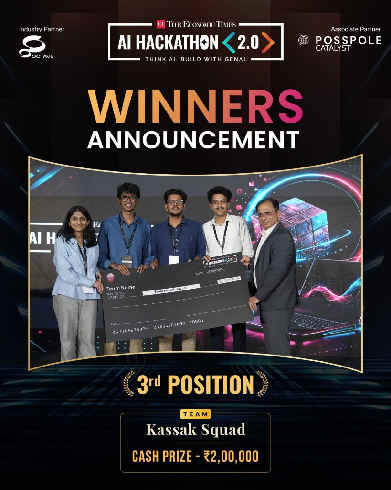
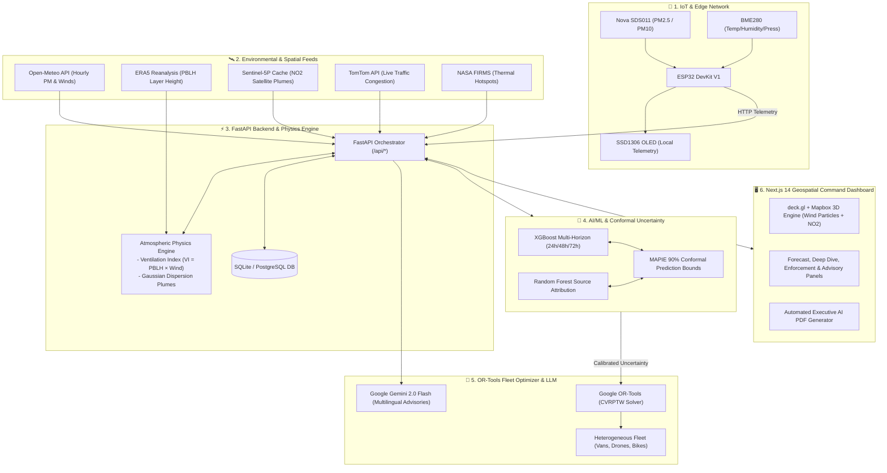

# 🏆 VayuBudhi (वायुबुद्धि)

> **The Calibrated Decision Layer for Urban Air Quality**  
> 🥉 **National 3rd Position** — **The Economic Times AI Hackathon 2.0** (T-Hub, Hyderabad) | Cash Prize: **₹2,00,000**

<div align="center">
  
</div>

---

### 🎖️ National Recognition — The Economic Times AI Hackathon 2.0

**VayuBudhi** was conceptualized, built, and defended as part of **The Economic Times AI Hackathon 2.0**, a premier national-level hackathon focused on developing innovative Artificial Intelligence-based solutions to mission-critical real-world challenges.

* **Team:** **Kassak Squad**
* **Team Members (3rd Year B.Tech Students):**
  * **Praharshita Tata**
  * **Purusharth Mishra**
  * **Sai Koushik Pallapolu**
  * **Veerabhadra Yerram**
* **National Standing:** Progressed across nationwide competitive rounds and selected into the **Top 30 teams** from approximately **10,000 teams** that registered from across India.
* **Grand Finale:** During the Finale Round held at **T-Hub, Hyderabad** on **25th August 2026**, the team finished **3rd Position** nationwide, winning a cash prize of **₹2,00,000 (Rs. 2 Lakhs)**.

During the hackathon, the team designed and built **VayuBudhi** — an intelligent, mathematically optimal decision layer built on top of urban air quality monitoring networks. Instead of just forecasting AQI or detecting pollution hotspots, VayuBudhi solves the harder operational problem: **Given a city's actual limited resources (inspectors, drones, and enforcement vans), what is the mathematically optimal way to deploy them?**

Crucially, the system quantifies its own uncertainty through conformal prediction, ensuring that valuable physical resources are never wasted on shaky evidence.

---

## 🌟 Key Features

VayuBudhi is built around 5 core modules designed to turn raw pollution signals into actionable, cost-effective interventions:

1. **Source Attribution with Calibrated Confidence**
   * Uses weak-supervision labeling and Random Forest classification to identify dominant pollution sources (vehicular, industrial, biomass, dust).
   * Wraps predictions in **MAPIE conformal prediction sets** to output mathematically calibrated confidence bounds (e.g., 90% certainty), feeding directly into the optimizer.
2. **Physics-Informed Hyperlocal Forecasting**
   * Forecasts AQI at 24/48/72-hour horizons using XGBoost.
   * Incorporates a custom engineered **Ventilation Index** (Boundary Layer Height × Wind Speed) to predict atmospheric stagnation events before pollution accumulates.
3. **Uncertainty-Aware Enforcement Optimizer**
   * Uses **Google OR-Tools (CVRPTW)** to calculate provably optimal routing for a heterogeneous fleet (drones, vans, inspectors).
   * Evaluates deployment based on Severity × Confidence × Population Exposure. Low-confidence signals are routed to cheap verification (drones) before committing full inspection teams.
4. **Multilingual Exposure-Dose Citizen Advisory**
   * Translates generic AQI numbers into personalized inhaled dose estimates ($\mu g/h$) based on user activity.
   * Leverages **Google Gemini API** to generate actionable, hyper-local health advisories in multiple languages (Hindi, English, Kannada).
5. **Real-Time IoT Sensor Network**
   * Low-cost (~₹3,150) custom ESP32 + SDS011 nodes capable of real-time PM2.5/PM10 monitoring and edge classification.
   * Demonstrates a sub-60-second response loop from physical particle detection to optimized inspector dispatch.

---

## 🏗️ System Architecture

VayuBudhi bridges physical IoT hardware with satellite atmospheric modeling, physics-informed machine learning, operations research dispatching, and generative AI advisories.



> 📖 *For the complete technical breakdown and data schema specifications, see [System Architecture Specification](docs/system_architecture.md).*

---

## 💻 Tech Stack

| Category | Technologies |
| :--- | :--- |
| **Backend API** | Python 3.11, FastAPI |
| **Database** | SQLite (Dev) / PostgreSQL (Prod) |
| **Machine Learning** | scikit-learn, XGBoost, MAPIE |
| **Operations Research** | Google OR-Tools |
| **Frontend & GIS** | Next.js 14, React, deck.gl, Mapbox GL JS |
| **LLM & Agents** | Google Gemini (gemini-2.0-flash), LangGraph |
| **IoT Hardware** | C++ (ESP32 Arduino Core), HTTPClient |

---

## 🛠️ Hardware Setup (Sensor Node)

To build the physical VayuBudhi IoT node, you will need the following components (Total cost ~₹3,150):

* 1x ESP32 DevKit V1
* 1x Nova SDS011 PM Sensor
* 1x BME280 Temperature/Humidity Sensor
* 1x 0.96" SSD1306 OLED Display
* Breadboard, jumper wires, and a 3D-printed enclosure.

The ESP32 reads real-time PM and weather data, displays the PM2.5/PM10 ratio locally on the OLED, and POSTs the JSON payload to the FastAPI backend over a local Wi-Fi hotspot.

---

## 🚀 Getting Started (Local Development)

*(Note: Ensure you have Python 3.11+ and Node.js 18+ installed on your system.)*

### 1. Clone the Repository
```bash
git clone https://github.com/your-org/vayubudhi.git
cd vayubudhi
```

### 2. Backend Setup (FastAPI & ML)
```bash
cd backend
python -m venv venv
source venv/bin/activate  # On Windows: venv\Scripts\activate
pip install -r requirements.txt
uvicorn app.main:app --reload
```

### 3. Frontend Setup (Next.js)
```bash
cd frontend
npm install
npm run dev
```

### 4. Environment Variables
Create a `.env` file in both the `backend` and `frontend` directories and add your API keys:
* `GEMINI_API_KEY`
* `MAPBOX_ACCESS_TOKEN`
* `TOMTOM_API_KEY`

---

## 📖 Documentation

All detailed system design specifications, physics formulas, and ML architectures have been organized in the [`docs/`](file:///d:/Puru_VNR/3rd%20Year/Hackathons%20&%20Competitions/Vayubudhi/vayubudhi/docs/README.md) directory:

* [**Detailed System Architecture & Diagram**](file:///d:/Puru_VNR/3rd%20Year/Hackathons%20&%20Competitions/Vayubudhi/vayubudhi/docs/system_architecture.md)
* [**System Architecture & Analysis**](file:///d:/Puru_VNR/3rd%20Year/Hackathons%20&%20Competitions/Vayubudhi/vayubudhi/docs/vayubudhi_comprehensive_analysis.md)
* [**ML Architecture & Data Blueprint**](file:///d:/Puru_VNR/3rd%20Year/Hackathons%20&%20Competitions/Vayubudhi/vayubudhi/docs/finalized_ml_architecture.md)
* [**Forecasting & Atmospheric Physics (PBLH)**](file:///d:/Puru_VNR/3rd%20Year/Hackathons%20&%20Competitions/Vayubudhi/vayubudhi/docs/ml_pipeline_and_aqi_forecasting_plan.md)
* [**Forecaster & Deep Dive Guide**](file:///d:/Puru_VNR/3rd%20Year/Hackathons%20&%20Competitions/Vayubudhi/vayubudhi/docs/aqi_forecaster_and_deepdive_guide.md)
* [**ML Evaluation Report (PDF)**](file:///d:/Puru_VNR/3rd%20Year/Hackathons%20&%20Competitions/Vayubudhi/vayubudhi/docs/vayu_budhi_ml_predictions_report.pdf)

---

## 🤝 Contributing
Since VayuBudhi is a tightly scoped project developed under a strict 1.5-week sprint timeline, please ensure any pull requests adhere directly to the core 5 modules outlined above. No scope creep.

## 📄 License
This project is licensed under the MIT License - see the [LICENSE](file:///d:/Puru_VNR/3rd%20Year/Hackathons%20&%20Competitions/Vayubudhi/vayubudhi/LICENSE) file for details.
