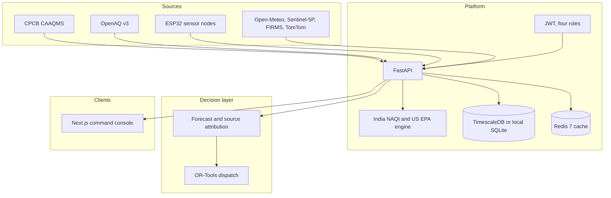

# VayuBudhi

Municipal air-quality decision and enforcement platform. VayuBudhi turns official station readings and field telemetry into a dispatch decision: where a limited fleet of inspectors, vans, and drones should go, and with what confidence.

## Recognition

Built by **Kassak Squad** for The Economic Times AI Hackathon 2.0.

| | |
|---|---|
| Team | Praharshita Tata, Purusharth Mishra, Sai Koushik Pallapolu, Veerabhadra Yerram |
| Result | National 3rd place, Top 30 of about 10,000 teams |
| Finale | T-Hub, Hyderabad, 25 August 2026 |
| Prize | ₹2,00,000 |

## Platform

- **Official monitoring.** CPCB CAAQMS and OpenAQ v3 are ingested on a 15-minute schedule. Wards without an active station are marked unmonitored and attributed to the nearest station.
- **Dual air-quality standards.** The console switches between India NAQI (CPCB 2014) and US EPA AQI.
- **Forecasting and source attribution.** XGBoost multi-horizon forecasts (24h, 48h, 72h) and a Random Forest source classifier (vehicular, industrial, biomass, dust), with MAPIE conformal intervals in the model stack.
- **Enforcement routing.** Google OR-Tools (CVRPTW) ranks patrol routes from severity, confidence, and exposure. The Enforce view is limited to city officers and super admins.
- **Citizen advisories.** Gemini 1.5 Flash drafts health advisories in English, Hindi, and Kannada.
- **Audit reports.** City and district environmental reports export to PDF.
- **Field hardware.** ESP32 nodes report PM2.5, PM10, and weather into the same pipeline.

Sign-in lives on the home page. Other sections use the session created there.

## Architecture



Detail is in [docs/system_architecture.md](docs/system_architecture.md).

## Tech stack

| Layer | Technologies |
|---|---|
| Frontend | Next.js 14, React 18, TypeScript, Mapbox GL JS, deck.gl |
| API | FastAPI, Python 3.11, Uvicorn, Pydantic v2 |
| Data | TimescaleDB / PostgreSQL 16, Redis 7, SQLite for local development, Alembic |
| Models | XGBoost, Random Forest, MAPIE, SHAP |
| Routing | Google OR-Tools (CVRPTW) |
| Advisories | Google Gemini 1.5 Flash, LangGraph |
| Feeds | CPCB (data.gov.in), OpenAQ v3, Open-Meteo ERA5, Sentinel-5P, NASA FIRMS, TomTom, OpenStreetMap |
| Hardware | ESP32, Nova SDS011, Bosch BME280 |
| Delivery | Docker Compose, JWT role checks, TLS |

Local development uses SQLite and an in-memory cache fallback. `docker compose up` starts TimescaleDB, Redis, the API, and the frontend together.

## Local setup

Python 3.11+ and Node.js 18+ are required.

```bash
git clone https://github.com/praharshita-t/vayubudhi.git
cd vayubudhi
```

Backend:

```bash
cd backend
python -m venv venv
# Windows: venv\Scripts\activate
# macOS/Linux: source venv/bin/activate
pip install -r requirements.txt
uvicorn app.main:app --reload --host 127.0.0.1 --port 8000
```

Frontend, in a second terminal:

```bash
cd frontend
npm install
npm run dev
```

Open [http://localhost:3000](http://localhost:3000). The API is at [http://127.0.0.1:8000](http://127.0.0.1:8000).

Optional environment variables:

| Variable | Used for |
|---|---|
| `DATAGOV_API_KEY` | CPCB CAAQMS ingestion |
| `OPENAQ_API_KEY` | OpenAQ v3 |
| `TOMTOM_API_KEY` | Traffic congestion |
| `GEMINI_API_KEY` | Advisory and report narration |
| `NEXT_PUBLIC_MAPBOX_TOKEN` | Map tiles |
| `DATABASE_URL` | PostgreSQL / TimescaleDB (defaults to local SQLite) |
| `REDIS_URL` | Redis (defaults to `redis://localhost:6379/0`) |
| `JWT_SECRET_KEY` | Token signing |
| `ALLOWED_ORIGINS` | CORS allowlist |

Place backend variables in `backend/.env`. Place `NEXT_PUBLIC_MAPBOX_TOKEN` in `frontend/.env.local`. The app starts without these keys and falls back to stored or local data where a live feed is unavailable.

## Hardware

The field node is an ESP32 with a Nova SDS011 particulate sensor, a Bosch BME280, and a local display. Build notes are in [hardware_demo_code/hardware_build_guide.md](hardware_demo_code/hardware_build_guide.md).

## Documentation

- [System architecture](docs/system_architecture.md)
- [Platform analysis](docs/vayubudhi_comprehensive_analysis.md)
- [ML architecture](docs/finalized_ml_architecture.md)
- [Forecasting and ventilation index](docs/ml_pipeline_and_aqi_forecasting_plan.md)
- [Forecaster and deep-dive guide](docs/aqi_forecaster_and_deepdive_guide.md)
- [Documentation index](docs/README.md)

## License

MIT. See [LICENSE](LICENSE).
