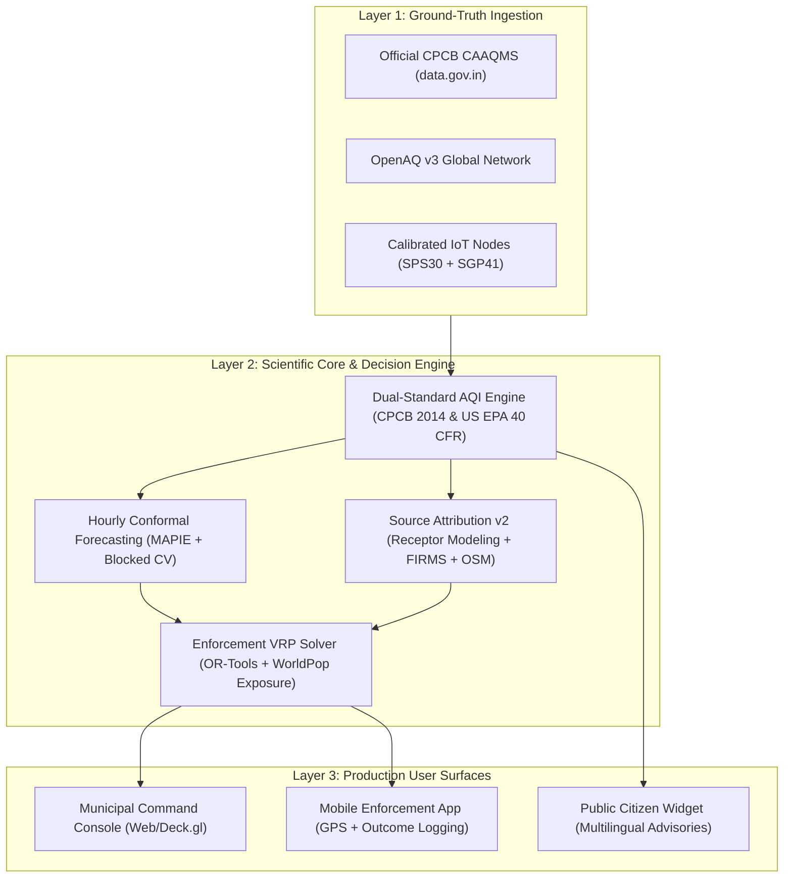

# VayuBudhi 2.0 — Startup-Scale Execution Plan & Implementation Blueprint

> **Document Status**: Active Implementation Blueprint  
> **Target Maturity**: Enterprise Production / Municipal Government Deployment  
> **Active Git Branch**: `feature/startup-scale-roadmap`  
> **Supersedes**: Hackathon Prototype Architecture & Legacy Audits  

---

## 1. Executive Vision & Core Value Proposition

VayuBudhi is an environmental **decision and closed-loop enforcement intelligence platform**. Rather than functioning as a passive AQI monitoring map, VayuBudhi solves the critical municipal optimization question:

> *"Given a municipal corporation's limited fleet of enforcement vans, field inspectors, and surveillance drones, where should they be dispatched right now, with what level of statistical certainty, and what is the measurable public health ROI of intervening?"*



---

## 2. Multi-Branch Code Audit & Asset Inventory

Before planning execution, we performed an exhaustive audit across all repository branches and commits to locate existing work and credentials:

| Branch / Location | Commit | Status / Contained Work |
| :--- | :---: | :--- |
| `feature/hardware-ai-verification-lab` | `cb5fc2a` | **Foundational Ingestion & Standards Built**: Contains `backend/app/ingestion/cpcb_worker.py`, `openaq_worker.py`, `scheduler.py`, `backend/app/aqi_standards.py`, and `setup_timescaledb.sql`. |
| `feat/frontend-enhancements` | `650eaa1` | **Documentation & UI Polish**: Centralized all technical audit documentation in `docs/audits_and_assessments/`. |
| `feature/startup-scale-roadmap` *(Active)* | `893aa88` | **Unified Startup Branch**: Created specifically to execute the 8-phase Startup-Scale Roadmap end-to-end. |
| `.env` (Local Workspace Disk) | *Gitignored* | **Active API Keys Configured**: `DATAGOV_API_KEY` (CPCB CAAQMS), `OPENAQ_API_KEY` (OpenAQ v3), `TOMTOM_API_KEY` (Traffic Congestion), and Open-Meteo endpoint configurations. Zero keys are committed into git history. |

---

## 3. The 8 Gated Phases: Detailed Step-by-Step Execution Plan

Each phase is **strictly gated**: a phase is declared complete only when its verifiable exit criteria are met.

```mermaid
gantt
    title VayuBudhi Startup-Scale Execution Timeline
    dateFormat  YYYY-MM-DD
    section Phase 0
    Gate G0: Truth Reset & Provenance         :done, p0, 2026-09-10, 2026-09-24
    section Phase 1
    Gate G1: Ingestion & Reliability Core      :active, p1, 2026-09-24, 2026-10-15
    section Phase 2
    Gate G2: Platform Foundation, CI/CD, Auth  :p2, 2026-10-15, 2026-11-05
    section Phase 3
    Gate G3: ML Credibility & Receptor Models  :p3, 2026-11-05, 2026-12-03
    section Phase 4
    Gate G4: IoT Fleet v1 & Field Calibration  :p4, 2026-11-15, 2027-01-15
    section Phase 5
    Gate G5: First Paid Municipal Pilot        :p5, 2027-01-15, 2027-04-15
    section Phase 6
    Gate G6: Productisation & 3-5 City Scale   :p6, 2027-04-15, 2027-09-15
```

---

### Phase 0: Truth Reset & Provenance (Gate G0)
> **Goal**: Ensure every number on screen is measured, modelled-and-labelled, or absent. Eliminate all synthetic multipliers and mock physics.

- **Step 0.1: Unify Ingestion & Standards Codebase**
  - Integrate `backend/app/aqi_standards.py` and `backend/app/ingestion/` from `cb5fc2a` into `feature/startup-scale-roadmap`.
  - Enforce strict CPCB criteria (minimum 3 pollutants with particulate requirement) and automatic CO unit normalization ($>5.0\,\mu\text{g/m}^3 \rightarrow \text{mg/m}^3$).
- **Step 0.2: Delete Legacy Fabrication Hacks**
  - Purge `i % 3` synthetic station multipliers in `live.py`.
  - Remove inverted PM2.5 calculation (`pm25 = cell_aqi * 0.4`).
  - Delete `micro_factor` and historical ratio-rescaling hacks.
  - Purge mock prediction intervals (`point * 0.9` / `point - 20`).
- **Step 0.3: Explicit Provenance Labelling**
  - Every API response must tag data with `provenance: "measured_caaqms" | "calibrated_iot" | "modelled_background"`.
  - Unmonitored districts display `monitored: false` with slate-grey rendering and nearest active station attribution.
- **Gate G0 Exit Criteria**:
  - `grep -rE "i % 3|random\.uniform|generateForecastData|micro_factor" backend/ ml_model/` returns 0 occurrences.
  - All stations in Hyderabad, Delhi, and Bengaluru return genuine government CAAQMS readings.

---

### Phase 1: Reliability Core & Ingestion Pipeline (Gate G1)
> **Goal**: Achieve 72 hours unattended operation with zero telemetry gaps and persistent time-series storage.

- **Step 1.1: Persistent Time-Series Storage (PostgreSQL + TimescaleDB)**
  - Execute `backend/app/scripts/setup_timescaledb.sql` to establish hypertables for `station_observations` and `iot_readings`.
  - Partition observations by 7-day intervals with native chunk compression.
  - Configure SQLite WAL mode for local developer environments.
- **Step 1.2: Resilient Asynchronous Ingestion Workers**
  - Wire `backend/app/ingestion/cpcb_worker.py` to query `api.data.gov.in` every 15 minutes.
  - Wire `backend/app/ingestion/openaq_worker.py` as an automatic fallback with exponential backoff and rate-limit tracking.
  - Run ingestion worker via `backend/app/ingestion/scheduler.py` with standalone process management.
- **Step 1.3: HTTP Client Pooling & Circuit Breakers**
  - Replace raw `requests.get` with centralized `httpx.AsyncClient` pooling.
  - Implement circuit breakers for Open-Meteo, TomTom, and NASA FIRMS: fail fast after 3 consecutive timeouts with cached fallback.
- **Step 1.4: Modular Backend Restructuring**
  - Decompose monolithic `live.py` into clean modular services:
    - `app/services/observations.py`: Station queries & database access.
    - `app/services/meteorology.py`: Atmospheric PBLH, wind, and dispersion.
    - `app/services/traffic.py`: TomTom corridor congestion integration.
    - `app/routers/live.py`: Lightweight FastAPI route definitions.
- **Gate G1 Exit Criteria**:
  - 72-hour unattended soak test with continuous 15-minute ingestion ticks.
  - Zero dropped connections or thread starvation under 100 concurrent requests.

---

### Phase 2: Platform Foundation, Security & CI/CD (Gate G2)
> **Goal**: Deployable, containerized, securely authenticated platform ready for municipal staging.

- **Step 2.1: Production Containerization**
  - Multi-stage `Dockerfile` for FastAPI backend (Python 3.11-slim, non-root user).
  - Standalone production `Dockerfile` for Next.js 13+ frontend.
  - Production `docker-compose.yml` linking API, Ingestion Worker, PostgreSQL/TimescaleDB, and Redis.
- **Step 2.2: Continuous Integration & Automated Quality Gates**
  - Setup GitHub Actions pipeline (`.github/workflows/ci.yml`):
    - Python linting (`ruff`) and static type verification (`mypy`).
    - Backend unit & contract tests (`pytest`).
    - Frontend build & type validation (`tsc --noEmit`, `eslint`).
    - Secret scanning (`gitleaks`) to prevent credential leakage.
- **Step 2.3: Security Hardening & Role-Based Access (RBAC)**
  - Implement JWT authentication (RS256) supporting 4 distinct tenant roles:
    - `super_admin`: Full system diagnostics and fleet management.
    - `city_officer`: Municipal dispatch approval and violation reporting.
    - `field_inspector`: Mobile view with GPS routing and photo evidence upload.
    - `public_viewer`: Read-only city ambient AQI map.
  - Restrict CORS from `*` to verified tenant origins.
- **Gate G2 Exit Criteria**:
  - CI pipeline passes on 100% of pull requests.
  - Zero high/critical vulnerabilities on automated vulnerability scanners.

---

### Phase 3: ML Credibility & Physical Receptor Modeling (Gate G3)
> **Goal**: Replace heuristic labeling with physics-grounded receptor models and true conformal uncertainty guarantees.

- **Step 3.1: Hourly Temporal Training on High-Density Data**
  - Shift training data from daily 2,178-row CSV to the 457,000-row hourly historical CAAQMS dataset.
  - Train CatBoost and XGBoost models on true 24h, 48h, and 72h continuous forecast targets.
  - Apply chronological/blocked time-series cross-validation (prohibiting random shuffling).
- **Step 3.2: True MAPIE Conformal Prediction Inference**
  - Replace the threshold shortcut (`probs > 0.10`) with genuine `MapieClassifier.predict()` and `MapieRegressor.predict()`.
  - Provide mathematically guaranteed 90% confidence sets ($\alpha = 0.10$) for source attribution.
- **Step 3.3: Multi-Signal Source Fingerprinting (Receptor Modeling)**
  - Replace 4-rule hand-coded labeling with multi-source weak supervision:
    - **Vehicular**: High TomTom congestion + high $\text{NO}_2/\text{PM}_{2.5}$ ratio during morning/evening commute peaks.
    - **Industrial**: High $\text{SO}_2$ + proximity to OpenStreetMap industrial land-use polygons.
    - **Biomass / Open Waste**: High $\text{PM}_{2.5}/\text{PM}_{10}$ ratio (>0.75) + NASA FIRMS MODIS/VIIRS thermal fire pixels within 15 km upwind.
    - **Dust**: High wind speed (>5 m/s) + low $\text{PM}_{2.5}/\text{PM}_{10}$ ratio (<0.35).
- **Step 3.4: True Pasquill-Gifford Gaussian Dispersion**
  - Replace mock plume inversion in `physics_engine.py` with validated Pasquill-Gifford dispersion parameterization based on atmospheric stability classes (A through F).
- **Gate G3 Exit Criteria**:
  - 24h forecast achieves $R^2 \ge 0.65$ on chronologically split test data.
  - Conformal prediction set maintains $\ge 88\%$ empirical coverage over 10,000 evaluation samples.

---

### Phase 4: IoT Hardware Fleet & Field Calibration (Gate G4)
> **Goal**: Build and deploy a 10-node pilot fleet, co-located alongside CPCB stations to establish certified calibration curves.

- **Step 4.1: Unified Industrial Firmware (PlatformIO)**
  - Unify firmware into a single modular PlatformIO C++ project (`iot_firmware/`).
  - Disable `MOCK_MODE` in all release builds.
  - Secure telemetry ingestion via MQTT over TLS 1.2 using X.509 client certificates or HTTPS with device tokens.
  - Implement non-volatile offline storage (SPIFFS flash queue) to buffer up to 2,000 readings during cellular downtime.
- **Step 4.2: Hardware 2.0 Bill of Materials (BOM)**
  - **Sensors**: Sensirion SPS30 (laser optical particulate monitor with built-in auto-cleaning fan) + Sensirion SGP41 (VOC & $\text{NO}_x$ indexes).
  - **MCU**: ESP32-S3-WROOM-1 (hardware crypto acceleration for TLS).
  - **Cellular & GNSS**: SIMCom SIM7000G (NB-IoT / LTE Cat-M1).
  - **Power & Weatherproofing**: BQ25185 MPPT solar charger + 3500mAh 18650 Li-ion battery + IP65 UV-stabilized enclosure with PTFE vent membrane.
- **Step 4.3: Empirical Field Calibration Study**
  - Co-locate 3 to 5 hardware nodes alongside an active government CAAQMS reference monitor (e.g. Sanjeevaiah Park or Zoo Park, Hyderabad) for 30+ consecutive days.
  - Apply on-device and cloud $\kappa$-Köhler Relative Humidity compensation:
    $$\text{PM}_{2.5\text{ corrected}} = \frac{\text{PM}_{2.5\text{ raw}}}{1 + \kappa \cdot \left(\frac{\text{RH}}{100 - \text{RH}}\right)}$$
  - Publish per-node regression metrics: slope, intercept, RMSE, and $R^2$.
- **Gate G4 Exit Criteria**:
  - 10 hardware nodes operating for 30 days with $>95\%$ network uptime.
  - Calibration regression yields $R^2 \ge 0.85$ and slope between $0.80$ and $1.20$ against reference analyzers.

---

### Phase 5: First Paid Municipal Pilot (Gate G5)
> **Goal**: Deploy 25–50 nodes in a single launch city, establish operational workflows, and sign a municipal pilot agreement.

- **Step 5.1: Target City Focus: Hyderabad**
  - Partner with Greater Hyderabad Municipal Corporation (GHMC) and Telangana State Pollution Control Board (TSPCB).
  - Target high-density industrial and traffic zones (Jeedimetla, Sanathnagar, Charminar corridor).
- **Step 5.2: Municipal Command Console & Dispatch Integration**
  - High-density Deck.gl map featuring real-time station vectors, hotspot clusters, and OR-Tools optimized patrol routes.
  - Exportable CPCB-compliant executive audit reports in clean PDF format.
- **Step 5.3: Field Outcome Data Loop (The Proprietary Moat)**
  - Mobile enforcement logging: field inspectors record whether an AI-flagged violation (e.g. open biomass burning or industrial fugitive emissions) was verified on-site.
  - Accumulate 200+ ground-truth verified field inspection records to iteratively retrain attribution classifiers.
- **Gate G5 Exit Criteria**:
  - Signed municipal pilot agreement with commercial terms.
  - 90 days continuous operation in 1–2 municipal zones.
  - Over 200 logged field inspection outcomes validating AI source attribution.

---

### Phase 6: Productisation & Scale (Gate G6)
> **Goal**: Expand to 3–5 cities with multi-tenant architecture, white-label APIs, and hardware certification.

- **Step 6.1: Multi-Tenant Architecture & Self-Serve Onboarding**
  - Tenant isolation at database schema level.
  - Self-serve city setup via automated OpenStreetMap ward boundary import.
- **Step 6.2: Regulatory Certification (CPCB Type Approval / MCERTS)**
  - Submit 90-day co-location data for official CPCB Type Approval under Indian Standard IS 5182.
- **Step 6.3: Data Licensing & Enterprise ESG APIs**
  - High-availability REST/WebSocket API providing hyperlocal air quality metrics to smart city integrators, real estate platforms, and health tech providers.

---

## 4. Immediate Sprint Backlog (Sprint 1: Phases 0 & 1)

| Task ID | Component | Action Item | Priority | Assigned Target |
| :--- | :--- | :--- | :---: | :--- |
| **S1-01** | Git Core | Merge `cb5fc2a` ingestion workers and AQI standards cleanly into `feature/startup-scale-roadmap` | **P0** | Immediate |
| **S1-02** | Backend | Wire `cpcb_worker.py` and `openaq_worker.py` into FastAPI startup lifecycle with background scheduler | **P0** | Immediate |
| **S1-03** | Database | Validate SQLite WAL mode and verify TimescaleDB schema migration script | **P0** | Sprint 1 |
| **S1-04** | ML | Replace probability threshold in `ml_service.py` with real MAPIE conformal sets | **P1** | Sprint 1 |
| **S1-05** | Frontend | Verify dynamic standard switcher (`[ 🇮🇳 NAQI | 🇺🇸 EPA ]`) and slate-grey unmonitored district hovers | **P1** | Sprint 1 |

---

## 5. Verification Commands

Run these automated commands to verify platform integrity at each milestone:

```bash
# 1. Verify Backend Unit Tests & AQI Standard Formulas
python -m pytest backend/app/test_endpoints.py backend/app/test_aqi_standards.py -v

# 2. Frontend Strict Type-Safety Check
cd frontend && npx tsc --noEmit

# 3. Codebase Fabrication Audit (Must return clean 0 matches)
git grep -E "i % 3|generateForecastData|micro_factor" backend/ ml_model/

# 4. Ingestion Worker Smoke Test
python -c "from app.ingestion.cpcb_worker import fetch_cpcb_realtime_data; print('Fetched records:', len(fetch_cpcb_realtime_data(limit=10)))"
```
