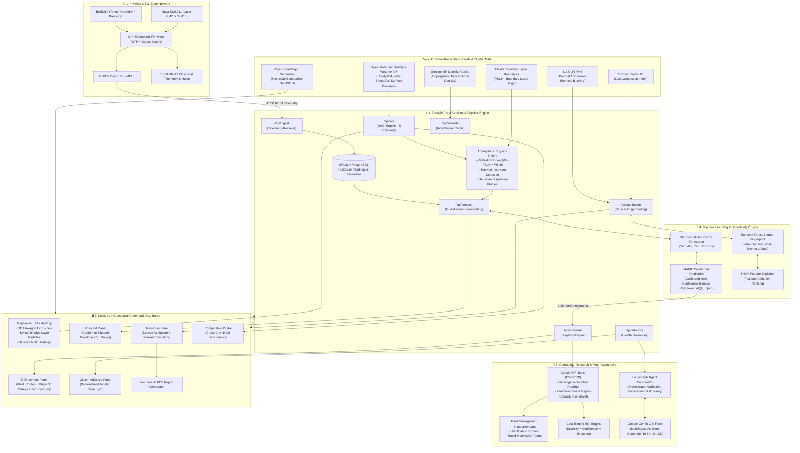

# 🏗️ VayuBudhi System Architecture

This document presents the detailed architectural design of **VayuBudhi**, mapping the flow of information from physical edge sensors and satellite feeds through atmospheric physics engines, machine learning forecasters, and operations research solvers down to real-time municipal dispatch and citizen advisories.

---

## 🌐 End-to-End System Architecture Diagram

---

## ⚙️ Core Subsystem Details

### 1. Physical Sensing Layer (`iot_firmware/`, `hardware_demo_code/`)
* **Hardware Profile:** Custom node built on an **ESP32 DevKit V1**, paired with a **Nova SDS011** laser scattering sensor and a **BME280** environmental sensor.
* **Firmware Intelligence:** Written in C++ (Arduino Core) with non-blocking tasks. Computes the real-time particulate ratio ($\text{Ratio} = \text{PM2.5} / \text{PM10}$):
  * **Ratio > 0.50:** Strong indication of secondary aerosol formation and fine combustion (vehicular / industrial).
  * **Ratio < 0.35:** Predominance of coarse mechanical particulate (road dust / construction).
* **Failsafe Offline Queue:** Telemetry is buffered in memory during network disconnections and flushed upon reconnection to ensure zero data loss.

### 2. Atmospheric Physics Subsystem (`backend/app/physics_engine.py`)
* **Ventilation Index ($VI$):** Quantifies the lower atmosphere's dilution capacity:
  $$VI = \text{Planetary Boundary Layer Height (PBLH)} \times \text{Surface Wind Speed } (U_{10})$$
  * **High $VI$ ($> 6,000 \ m^2/s$):** Rapid vertical mixing and advection $\to$ Low ground-level risk.
  * **Low $VI$ ($< 1,000 \ m^2/s$):** Atmospheric stagnation with thermal inversion $\to$ Trapped ground-level pollutants.
* **Gaussian Plume Dispersion:** Calculates forward downwind pollutant spread using Pasquill-Gifford atmospheric stability classes.

### 3. Machine Learning & Conformal Prediction (`ml_model/`)
* **Multi-Horizon Regressors:** Three XGBoost regressors trained on multi-year spatio-temporal datasets for **24h, 48h, and 72h** horizons.
* **MAPIE Conformal Uncertainty:** Wraps point estimates with distribution-free prediction intervals $[AQI_{\text{lower}}, AQI_{\text{upper}}]$ at a guaranteed **90% confidence level**.
* **Weak-Supervision Source Attribution:** Random Forest classifier attributing pollution to one of four classes: *Vehicular, Industrial, Biomass Burning, or Mechanical Dust*. Cross-referenced with live TomTom congestion data and NASA FIRMS satellite fire hotspots.

### 4. Operations Research & Enforcement Routing (`backend/app/optimization/`)
* **Google OR-Tools (CVRPTW):** Solves the Capacitated Vehicle Routing Problem with Time Windows across heterogeneous vehicles:
  * **Inspection Vans:** Heavy regulatory enforcement and sample collection.
  * **Verification Drones:** Fast, low-cost aerial confirmation of low-confidence hotspots before deploying heavy squads.
  * **Rapid Motorbikes:** Quick response in dense, congested urban alleyways.
* **Uncertainty-Aware Objective:**
  $$\text{Priority Score} = \text{Severity} \times \text{Conformal Confidence} \times \text{Population Exposure}$$

### 5. Multi-Agent Advisory & Multilingual LLM (`agent_advisor/`)
* **LangGraph Pipeline:** Orchestrates coordination between attribution data, city demographics, and health recommendations.
* **Gemini 2.0 Flash:** Generates localized, context-aware citizen advisories translated into **English, Hindi, and Kannada**, computing personalized inhaled dose estimates ($\mu g/h$) for runners, children, and outdoor workers.

### 6. Geospatial Command Dashboard (`frontend/`)
* **Rendering Engine:** Built with Next.js 14, Mapbox GL JS, and deck.gl for 3D volumetric extrusion of district boundaries.
* **Wind Layer:** Real-time particle stream animation (`WindLayer.ts`) visualizing wind vectors from Open-Meteo across urban terrain.
